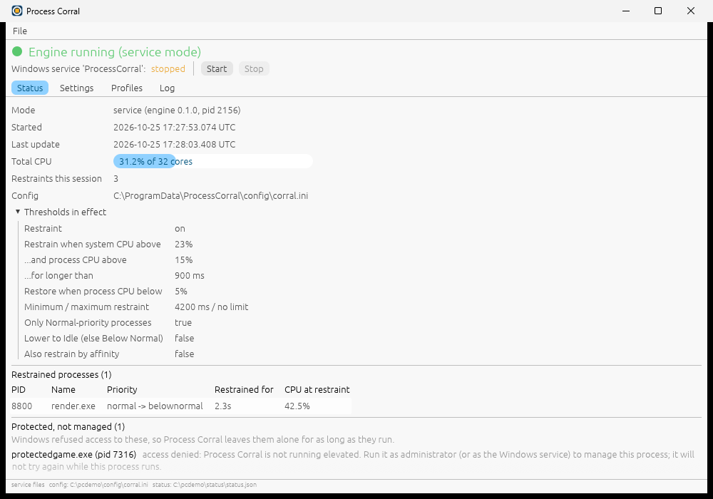
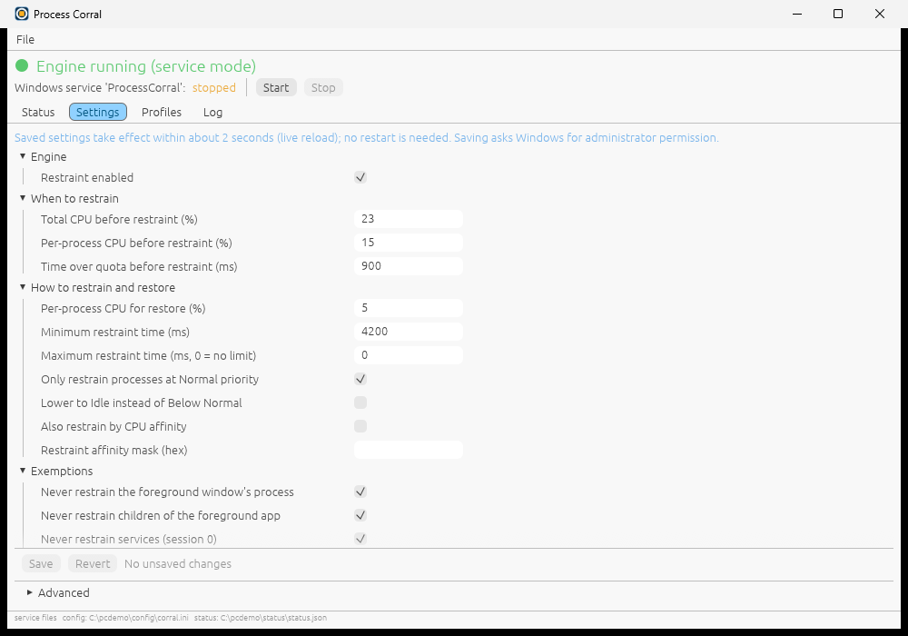
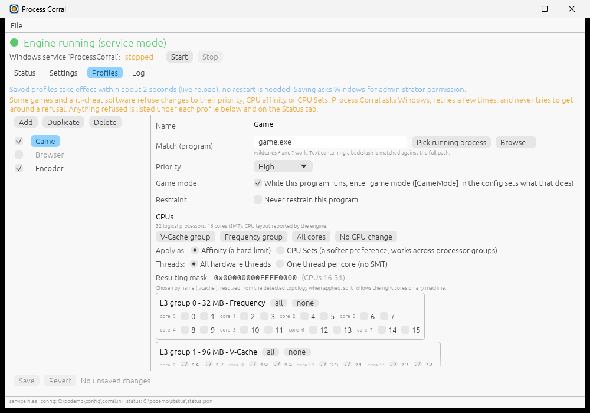
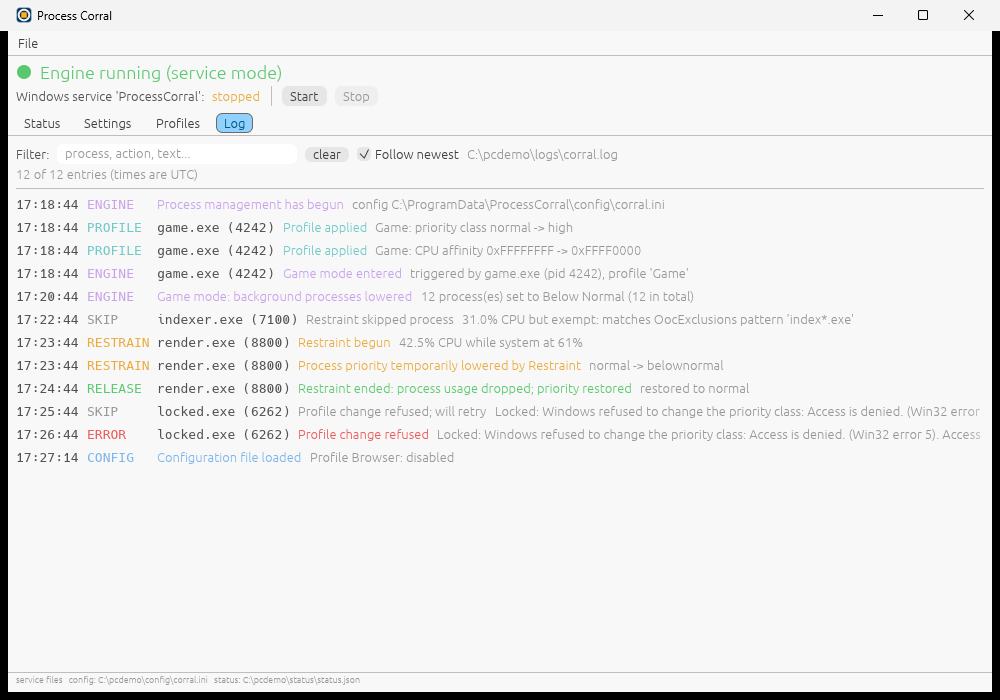

# Using Process Corral

Process Corral has two programs:

- `process-corral.exe` is the **engine**. It is the Windows service, a command line tool, and the helper the GUI uses for anything that needs administrator rights.
- `process-corral-gui.exe` is the optional **window and tray icon**. It never changes processes itself; it reads the engine's status file and log, and asks the engine to do things.

## Where things live

| What | Service (the normal case) | Console mode (`run` without `--system`) |
| --- | --- | --- |
| Config | `C:\ProgramData\ProcessCorral\config\corral.ini` | `%APPDATA%\ProcessCorral\config\corral.ini` |
| Log | `C:\ProgramData\ProcessCorral\logs\corral.log` | `%APPDATA%\ProcessCorral\logs\corral.log` |
| Status | `C:\ProgramData\ProcessCorral\status\status.json` | `%APPDATA%\ProcessCorral\status\status.json` |

(`C:\ProgramData` is whatever `%ProgramData%` is on your machine.) Command line flags `--config`, `--log` and `--status` override these.

- The **log** is a CSV file with the columns `UTC`, `UTCText`, `Machine`, `User`, `PID`, `Basename`, `ActionId`, `Action`, `Info`, `Path`. Times are UTC. It is rotated by size; see [Log files and rotation](#log-files-and-rotation).
- The **status file** is JSON, rewritten about every 2 seconds (atomically, so a reader never sees half a file). When the engine stops cleanly a last copy is written with `"state": "stopped"`. Readers should treat a "running" file whose `updated_at` is old as stale. The GUI does so after 10 seconds, or three update intervals if that is longer, or when the recorded process id no longer exists.

## The GUI

Start it from the Start menu (or `process-corral-gui.exe`). Only one window runs at a time; starting it again brings the existing window forward.

Closing the window with the X **hides it to the tray**; the engine keeps running either way. To really quit the GUI use **File > Exit (the service keeps running)** or the tray menu's Exit. **File > Hide to tray** does the same as the X.

### The header (all tabs)

- A big line: **Engine running (service mode)** in green, or **Engine not running** in red with the reason (for example "no status file yet", "the engine shut down cleanly", "no update for 42s", "process 1234 is gone").
- **Windows service 'ProcessCorral'**: its state (running, stopped, not installed, starting, stopping) and two buttons, **Start** and **Stop**. Each asks Windows for administrator permission (the UAC prompt). They are greyed out when they make no sense (for example Start while it is running), when another action is in progress, or when `process-corral.exe` is not next to the GUI.
- A message line shows the result of the last action, with a *dismiss* link.

### Status tab



Shows what the engine is doing right now (greyed out when it is not running, showing the last session's data):

- mode, engine version and process id, when it started, last update, total CPU, number of restraints this session, and the config file in use;
- **Thresholds in effect**: the Restraint settings the engine is using;
- **Restrained processes**: what is currently lowered, from which priority to which, and for how long;
- **Protected, not managed**: processes Windows refused Restraint access to. Process Corral leaves them alone while they run (shown only when there are any);
- **Top processes by CPU**;
- **Profiles and game mode**: CPU layout, whether game mode is active, what each profile did to each matching process (applied, differs, retrying, refused), and a list of refused changes;
- **Recent events**.

### Settings tab



The Restraint settings in four groups (Engine, When to restrain, How to restrain and restore, Exemptions). These correspond one to one to the keys in [CONFIG.md](CONFIG.md#outofcontrolprocessrestraint). Changed fields get a `*`, mistakes are shown next to the field.

- **Save** checks your values, then asks Windows for administrator permission and writes the file. **Revert** throws away unsaved edits.
- If the file changes on disk while you are editing, Save is disabled and you press **Revert** to load the new version, so nothing is silently overwritten.
- Below the form, the per-application lists (`DefaultPriorities`, `DefaultAffinities`, `DisallowedProcesses`, `InstanceLimitedProcesses`) are shown **read-only**; edit them in the file.
- At the bottom, a collapsed **Advanced** section has **Install service** and **Uninstall service**. The installer normally does this for you. Uninstall asks first (it names the service and says your settings and logs are kept).

### Profiles tab



A list of profiles on the left (the tick box enables or disables a profile) with **Add**, **Duplicate** and **Delete**; an editor on the right. See [PROFILES.md](PROFILES.md) for what the fields mean.

- **Match (program)**: type an exe name, press **Pick running process** to choose from what is running, or **Browse...** to choose an `.exe` (only its file name is used).
- **Priority**, **Game mode**, **Restraint** (never restrain this program).
- **CPUs**: quick buttons (**V-Cache group**, **Frequency group**, **All cores**, **No CPU change**), **Apply as** Affinity or CPU Sets, **Threads** (all, or one per core), and a checkbox per logical processor grouped by L3 cache group. The resulting mask is shown. The buttons are greyed out when the machine has no such group.
- Under a profile that is running, the Status tab shows what actually happened.

Saving works like the Settings tab (administrator prompt, applied within about 2 seconds).

### Log tab



The newest entries of the log file (up to 500; the tab says so when older ones exist), colour-coded by kind (engine, restrain, release, skip, profile, config, error). The box filters by text, **Follow newest** keeps the view at the bottom. Times are UTC.

### Log files and rotation

The log would otherwise grow forever, so it rotates by size. When `corral.log` reaches `MaxLogSizeMB` (default 10) it is renamed `corral.1.log`, the older ones move up one number (`corral.1.log` becomes `corral.2.log`, and so on), the one past `KeepLogFiles` (default 5) is deleted, and a new `corral.log` starts with the CSV header row. `KeepLogFiles=0` keeps no old files and simply empties the log. The files sit next to `corral.log` (or next to whatever `--log` names) and inherit the folder's permissions (in the service's `C:ProgramDataProcessCorral` folder: administrators write, ordinary users read); they are never made world-writable. Both settings are in [`[Logging]`](CONFIG.md#logging) and apply on a live reload.

Rotation never stops the engine. If the file cannot be renamed (another program has it open without allowing renames, or access is denied) the engine logs **"Log rotation failed (non-fatal)"** once, keeps appending to the current file so no line is lost, and tries again about 30 seconds later. See [Troubleshooting](TROUBLESHOOTING.md#log-rotation-failed).

The Log tab always follows the current `corral.log`: after a rotation it switches to the new, short file by itself. It does not open the rotated files; read `corral.1.log` and the others in a text editor or Excel. The Status tab's recent events are not affected by rotation.

### Which files the GUI reads

Normally the service's files under `C:\ProgramData\ProcessCorral`. If those do not exist but the per-user console files do, it uses the per-user ones. The footer shows which. Start it with `--system` or `--user` to force one, and `--config`, `--log`, `--status` to point at specific files. `--tab status|settings|profiles|log` chooses the first tab.

## The tray icon

- The icon shows a green dot when the engine is running and a grey dot (desaturated icon) when it is not. The tooltip reads, for example, "Process Corral - engine running (service running)".
- Left click or double-click opens the window.
- Right click opens a menu: **Open**, **Start service**, **Stop service**, **Exit (service keeps running)**. Start and Stop are greyed out unless they apply.
- If Windows will not give the program a tray icon, closing the window quits the GUI instead of hiding it.

## Starting and stopping the service

From the GUI use **Start** and **Stop** in the header, or the tray menu. Each asks for administrator permission.

From PowerShell (elevated):

```powershell
& "C:\Program Files\ProcessCorral\process-corral.exe" start
& "C:\Program Files\ProcessCorral\process-corral.exe" stop
Get-Service ProcessCorral
```

Stopping the service restores every priority the engine lowered, and undoes profile changes and game mode, before it reports "stopped". Windows also does this when it shuts down.

## Editing settings

Two ways:

1. **In the GUI** (Settings or Profiles tab) and press Save. The GUI writes your settings to a temporary file in your own temp folder and runs `process-corral.exe apply-config <that file>` with administrator rights. That command validates the config and, only if it is valid, installs it atomically as the service's config. The temporary file is then deleted.
2. **By hand**: edit `C:\ProgramData\ProcessCorral\config\corral.ini` in an editor running as administrator (ordinary users can read the folder but not write to it).

Either way the running engine notices the change within **about 2 seconds** (it checks the file's time stamp and size every 2 seconds) and applies it without a restart. A file with a mistake is **not** applied: the engine logs "Config reload failed; keeping previous settings" with the line number and keeps working with the old settings. See [Troubleshooting](TROUBLESHOOTING.md#config-rejected).

## Command line

`process-corral.exe` with no arguments (or an unknown one) prints a short help. The built-in help calls the program `corral`; the real name is `process-corral.exe`. Commands marked *(elevated)* need an administrator PowerShell.

### `run`

Run the engine in this console. Press Ctrl+C to stop; it restores everything it changed first.

```powershell
process-corral run
process-corral run --quiet                                  # do not echo events to the console
process-corral run --config .\test.ini --log .\test.log     # try a config without touching the real one
process-corral run --system                                 # use the ProgramData folder, like the service
```

Options: `--config FILE`, `--log FILE`, `--status FILE`, `--quiet`, `--system`. If the config file does not exist it starts with the defaults and picks the file up if it appears. If the file exists but is invalid it refuses to start. Only one engine can run at a time (console or service): see [Troubleshooting](TROUBLESHOOTING.md#already-running-instance-lock).

### `install` *(elevated)*

Register the auto-start service `ProcessCorral` (LocalSystem). It does not start it.

```powershell
process-corral install
process-corral install --config D:\pc\corral.ini --log D:\pc\corral.log   # custom locations recorded in the service
```

Creates `C:\ProgramData\ProcessCorral` (with restricted permissions) and a default config when you use the default locations. Refuses if the service already exists.

### `uninstall` *(elevated)*

Stop the service if it is running, then remove it. Your config and logs are left in place.

```powershell
process-corral uninstall
```

### `start`, `stop` *(elevated)*

```powershell
process-corral start
process-corral stop
```

### `service`

The entry point Windows uses to run the service. Do not run it yourself: from a console it only prints a hint.

### `init`

Write a default config file if there is none. It never overwrites an existing file.

```powershell
process-corral init                       # %APPDATA%\ProcessCorral\config\corral.ini
process-corral init --system              # C:\ProgramData\ProcessCorral (needs an elevated shell to create the folder)
process-corral init --config .\my.ini
```

### `apply-config` *(elevated)*

Validate a config file and install it as the service's config. This is what the GUI's Save uses.

```powershell
process-corral apply-config .\new-corral.ini
process-corral apply-config .\new-corral.ini --config D:\pc\corral.ini   # a different destination
```

The file is read once into memory (limit 1 MiB), checked, and only then written, atomically. An invalid file is never written. Exit codes: `0` ok, `2` usage, `3` not elevated, `4` source unreadable or too large, `5` invalid config, `6` could not write the destination.

### `topology`

Show the CPUs as Process Corral sees them: cores, hardware threads, L3 cache groups, which group is "vcache" and which is "frequency", and the masks that profiles produce.

```powershell
process-corral topology
process-corral topology --json
process-corral topology --simulate 9950x3d        # preview a machine you do not have
```

`--simulate` takes `9950x3d`, `9950x3d-ccd1` (the V-Cache CCD is the second one), `quad`, or `128` (two processor groups). The built-in help does not list `128`.

### `top`

A one-second CPU sample of the busiest processes, observe only. Nothing is changed.

```powershell
process-corral top --count 20      # default is 15
```

Handy for finding the exact exe name to use in a profile.

### `burn`

Use CPU on purpose, for testing Restraint. Run it in one console while `process-corral run` runs in another with low thresholds.

```powershell
process-corral burn --threads 4 --secs 30     # defaults: 2 threads, 20 seconds
```
